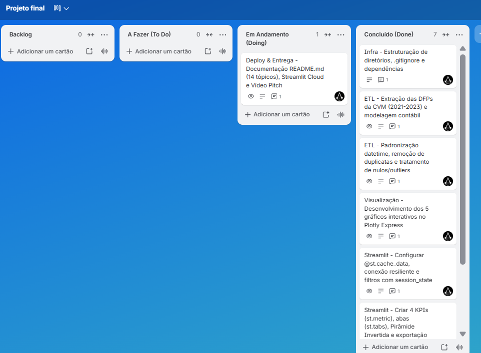

# 📊 Inteligência Fundamentalista & Contabilidade Corporativa (CVM / DFP) — Linha 1

> 🚀 **Aplicação em Produção (Streamlit Community Cloud):** [https://projetofinalsctec3-67lzku9whwz6gv5tnxggxu.streamlit.app/](https://projetofinalsctec3-67lzku9whwz6gv5tnxggxu.streamlit.app/)  
> 📋 **Quadro Kanban de Gestão Ágil (Trello):** [https://trello.com/invite/b/6af11647dfbaa34accb6b11e/ATTI90de37ac76add0819a76fc7ac35629d5964A6FE3/projeto-final](https://trello.com/invite/b/6af11647dfbaa34accb6b11e/ATTI90de37ac76add0819a76fc7ac35629d5964A6FE3/projeto-final)

---

## 1. Título e Resumo Executivo

**BI Fundamentalista CVM (Linha 1 — Análise Fundamentalista & Contabilidade Corporativa)** é uma aplicação corporativa interativa de Business Intelligence e Analytics Financeiro desenvolvida em **Python**, **Pandas**, **Streamlit** e **Plotly Express**.

O projeto investiga a saúde econômico-financeira, a eficiência operacional, o retorno aos acionistas e a estrutura de solvência/alavancagem de **12 companhias abertas de grande porte listadas na B3** durante o triênio pós-pandemia (**exercícios fiscais de 2021, 2022 e 2023**), a partir das **Demonstrações Financeiras Padronizadas (DFP)** oficiais submetidas à **Comissão de Valores Mobiliários (CVM)**.

---

## 2. Contexto de Negócio e Pergunta Orientadora

No cenário de alta volatilidade macroeconômica entre 2021 e 2023 — marcado pelo choque inflacionário global, elevação da taxa Selic para 13,75% a.a. e normalização dos preços internacionais de *commodities* — gestores de portfólio, analistas de crédito e diretores financeiros (CFOs) enfrentam o desafio de distinguir companhias com geração resiliente de caixa e rentabilidade real daquelas vulneráveis ao custo de capital e ao aperto de liquidez no curto prazo.

### Pergunta Orientadora Principal
> *Como evoluíram a geração de receita, as margens operacionais, o retorno sobre o patrimônio líquido (ROE) e a vulnerabilidade financeira (Liquidez Corrente e Dívida Líquida) das principais companhias abertas brasileiras entre 2021 e 2023?*

### Perguntas de Negócio Oficiais Respondidas pela Aplicação
1. **Crescimento e Contração de Receita:** Quais empresas e setores apresentaram maior crescimento de Receita Líquida entre 2021 e 2023, e quem sofreu contração/acomodação pós-pandemia?
2. **Remuneração ao Acionista:** Qual companhia entregou o maior ROE (%) para os acionistas e como a Margem Líquida se comportou ao longo dos exercícios?
3. **Eficiência Operacional Setorial:** Como a estrutura de custos impactou o resultado operacional (Margem EBIT %) das companhias industriais frente a *commodities* e serviços/varejo?
4. **Solvência e Risco de Liquidez:** Quais empresas apresentam maior vulnerabilidade financeira em termos de Liquidez Corrente (`< 1,5x`) e endividamento por Dívida Líquida?
5. **Concentração Setorial:** Como se distribui a geração de receita entre os diferentes setores econômicos no exercício fiscal mais recente (2023)?

---

## 3. Fonte de Dados e Licença

- **Fonte Oficial:** Portal de Dados Abertos da Comissão de Valores Mobiliários (CVM) — [Demonstrações Financeiras Padronizadas (DFP)](https://dados.cvm.gov.br/dados/CIA_ABERTA/DOC/DFP/DADOS/)
- **Licença e Conformidade Legal:** Dados públicos abertos governamentais sob a Política de Dados Abertos do Governo Federal, em estrita conformidade com a LGPD (Lei nº 13.709/2018), contendo exclusivamente informações contábeis de pessoas jurídicas de capital aberto.
- **Período Temporal Obrigatório:** Exercícios fiscais anuais encerrados em **2021, 2022 e 2023** (`ORDEM_EXERC == "ÚLTIMO"`).
- **Arquivos Padronizados Consumidos:**
  - `dfp_cia_aberta_DRE_con_XXXX.csv` (Demonstração do Resultado Consolidada)
  - `dfp_cia_aberta_BPA_con_XXXX.csv` (Balanço Patrimonial Ativo Consolidado)
  - `dfp_cia_aberta_BPP_con_XXXX.csv` (Balanço Patrimonial Passivo Consolidado)
- **Universo de Companhias Analisadas (12 empresas):**
  - `ABEV3` (Ambev — Consumo / Bebidas)
  - `EGIE3` (Engie Brasil — Energia Elétrica)
  - `EMBJ3` / `EMBR3` (Embraer — Bens Industriais / Aviação)
  - `GGBR4` (Gerdau — Siderurgia e Metalurgia)
  - `ITUB4` (Itaú Unibanco — Financeiro / Bancos)
  - `JBSS3` (JBS — Consumo / Alimentos)
  - `KLBN11` (Klabin — Papel e Celulose)
  - `LREN3` (Lojas Renner — Varejo)
  - `PETR4` (Petrobras — Petróleo e Gás)
  - `SUZB3` (Suzano — Papel e Celulose)
  - `VALE3` (Vale — Mineração)
  - `WEGE3` (WEG — Bens Industriais)

---

## 4. Pipeline de Engenharia de Dados (ETL)

O pipeline reprodutível de Engenharia de Dados foi construído utilizando **caminhos 100% relativos** (`pathlib.Path`) e dividido em três etapas modulares:

1. **Extração e Padronização (`notebooks/eda_cvm_linha1.py`):**
   - Download automatizado dos pacotes `.zip` anuais diretamente do repositório oficial da CVM (2021, 2022 e 2023) com cache local em `data/raw/`.
   - Leitura com tratamento de encoding (`latin1` na origem CVM para `utf-8-sig` na camada analítica).
   - Filtragem exclusiva do último exercício reportado (`ORDEM_EXERC == "ÚLTIMO"`) e deduplicação por versão de reapresentação societária (`sort_values("VERSAO").drop_duplicates(..., keep="last")`).
   - Conversão de tipos monetários (`VL_CONTA` para `float`) e harmonização de escala monetária (`ESCALA_MOEDA == "MIL"` convertido para `R$ Milhões`).
   - Mapeamento do plano de contas contábil (`3.01`, `3.03`, `3.05`, `3.11`, `1.01`, `1.01.01`, `1.01.02`, `2.01`, `2.01.04`, `2.02.01`, `2.03`/`2.08`) e cálculo dos indicadores fundamentalistas.
2. **Limpeza, Imputação e Auditoria de Outliers (`src/etl_cleaning.py`):**
   - Padronização de datas para formato ISO (`YYYY-MM-DD`).
   - Tratamento de valores ausentes decorrentes de particularidades contábeis setoriais (como o plano COSIF aplicável ao setor bancário em `ITUB4`), utilizando mediana setorial/anual com rastreabilidade explícita via flag booleana (`FLG_DADO_IMPUTADO`).
   - Detecção estatística de *outliers* pelo método do Intervalo Interquartil ($IQR = Q_3 - Q_1$) e *Z-Score*, gerando colunas suavizadas por *Winsorization* (`_CLIP`) e exportando um log de auditoria em `data/processed/auditoria_outliers_linha1.csv`.
3. **Carregamento Resiliente e Cache Otimizado (`app.py`):**
   - Leitura estruturada da base analítica local (`data/processed/cvm_indicadores_linha1_tratado.csv`) protegida por bloco `try/except` com *fallback* automático para a base consolidada (`cvm_indicadores_linha1_2021_2023.csv`) e otimização em memória via decorador `@st.cache_data(ttl=3600)`.

---

## 5. Dicionário de Dados

A tabela abaixo documenta a estrutura da base analítica processada (`data/processed/cvm_indicadores_linha1_tratado.csv`):

| Nome da Coluna | Tipo Primitivo | Descrição e Significado Financeiro | Regra de Cálculo / Origem CVM |
| :--- | :--- | :--- | :--- |
| `TICKER` | `string` | Código de negociação da companhia na B3 | Mapeamento via `CNPJ_CIA` |
| `EMPRESA` | `string` | Nome empresarial simplificado da companhia aberta | Mapeamento via `CNPJ_CIA` |
| `SETOR` | `string` | Classificação setorial econômica da companhia | Mapeamento setorial CVM/B3 |
| `ANO` | `int` | Exercício fiscal de referência da demonstração | `YEAR(DT_REFER)` (2021, 2022, 2023) |
| `DT_REFER` | `string (date)` | Data de encerramento do exercício fiscal (`YYYY-MM-DD`) | Padronização ISO de `DT_REFER` |
| `RECEITA_LIQUIDA_MM` | `float` | Receita Líquida de Vendas e/ou Serviços em R$ Milhões | Conta `3.01` (`DRE_con`) |
| `LUCRO_BRUTO_MM` | `float` | Resultado Bruto em R$ Milhões | Conta `3.03` (`DRE_con`) |
| `EBIT_MM` | `float` | Resultado Operacional antes do Resultado Financeiro e Tributos (R$ MM) | Conta `3.05` (`DRE_con`) |
| `LUCRO_LIQUIDO_MM` | `float` | Lucro/Prejuízo Líquido Consolidado do Exercício (R$ MM) | Conta `3.11` (`DRE_con`) |
| `ATIVO_CIRCULANTE_MM` | `float` | Total do Ativo Circulante (direitos realizáveis em até 12 meses, R$ MM) | Conta `1.01` (`BPA_con`) |
| `PASSIVO_CIRCULANTE_MM` | `float` | Total do Passivo Circulante (obrigações exigíveis em até 12 meses, R$ MM) | Conta `2.01` (`BPP_con`) |
| `PATRIMONIO_LIQUIDO_MM` | `float` | Patrimônio Líquido Consolidado (Capital Próprio, R$ MM) | Conta `2.03` / `2.08` (`BPP_con`) |
| `DIVIDA_LIQUIDA_MM` | `float` | Endividamento líquido em R$ Milhões (valores negativos indicam Caixa Líquido) | `(2.01.04 + 2.02.01) - (1.01.01 + 1.01.02)` |
| `MARGEM_BRUTA_PCT` | `float` | Eficiência produtiva direta sobre a receita líquida (%) | `(LUCRO_BRUTO_MM / RECEITA_LIQUIDA_MM) * 100` |
| `MARGEM_EBIT_PCT` | `float` | Rentabilidade operacional sobre a receita líquida (%) | `(EBIT_MM / RECEITA_LIQUIDA_MM) * 100` |
| `MARGEM_LIQUIDA_PCT` | `float` | Conversão final de receita líquida em lucro líquido (%) | `(LUCRO_LIQUIDO_MM / RECEITA_LIQUIDA_MM) * 100` |
| `ROE_PCT` | `float` | Retorno sobre o Patrimônio Líquido (*Return on Equity*, %) | `(LUCRO_LIQUIDO_MM / PATRIMONIO_LIQUIDO_MM) * 100` |
| `LIQUIDEZ_CORRENTE` | `float` | Capacidade de pagamento de obrigações de curto prazo (índice `x`) | `ATIVO_CIRCULANTE_MM / PASSIVO_CIRCULANTE_MM` |
| `FLG_DADO_IMPUTADO` | `bool` | Indicador de governança que sinaliza se houve imputação setorial de nulos | `True` se imputado; `False` caso original |

---

## 6. Tecnologias e Bibliotecas

- **Python 3.12+**: Linguagem base para engenharia de dados, modelagem estatística e construção da aplicação web.
- **Pandas & NumPy**: Manipulação vetorial de séries contábeis, agregações multidimensionais, higienização de tipos e cálculos de *quantis*/IQR.
- **Plotly Express & Graph Objects**: Construção dos 5 elementos visuais interativos de padrão executivo em tema Dark (barras agrupadas, barras horizontais ordenadas / mapa de árvore setorial, matriz de quadrantes com bolhas, *boxplot* setorial com rótulos codificados por cor e gráfico misto de eixo duplo para solvência).
- **Streamlit**: Framework de *Data App* corporativo com gerenciamento de cache (`@st.cache_data`), persistência reativa de filtros (`st.session_state`), cartões de KPI (`st.metric`) e exportação instantânea (`st.download_button`).
- **Requests & Zipfile**: Consumo automatizado e descompactação em memória dos pacotes de dados abertos da CVM via protocolo HTTPS.

---

## 7. Principais Resultados e Evidências Numéricas

A análise consolidada dos demonstrativos contábeis de 2021 a 2023 para a carteira das 12 companhias revela achados fundamentais apoiados em evidências numéricas:

1. **Dinâmica de Receita Líquida (2021–2023):**
   - A **Petrobras (`PETR4`)** e a **JBS (`JBSS3`)** lideram em escala absoluta de faturamento na carteira, superando individualmente a faixa de R$ 350 bilhões anuais.
   - Exportadoras de *commodities* metálicas e energéticas (`PETR4`, `VALE3` e `GGBR4`) atingiram pico de receita nominal em 2022 impulsionadas pelo ciclo de preços internacionais no pós-pandemia, apresentando acomodação em 2023.
   - Em contrapartida, companhias industriais de alta tecnologia agregada como **WEG (`WEGE3`)** (crescimento contínuo de R$ 23,56 bi em 2021 para R$ 32,50 bi em 2023, alta de **+37,9%**) e **Embraer (`EMBJ3`)** expandiram suas receitas de forma consistente no triênio.
2. **Rentabilidade e Retorno ao Acionista (ROE e Margem Líquida):**
   - `PETR4`, `VALE3`, `WEGE3` e `EGIE3` destacaram-se no quadrante superior de eficiência, combinando **ROE acima de 20%** e **Margem Líquida superior a 15%** na média do período.
   - Em 2023, a **WEG (`WEGE3`)** e a **Suzano (`SUZB3`)** mantiveram forte geração de valor ao acionista, enquanto setores intensivos em proteína animal (`JBSS3`) enfrentaram compressão cíclica de margens em 2023 devido ao ciclo pecuário e custos de insumos.
3. **Eficiência Operacional entre Setores (Margem EBIT):**
   - Setores de concessões elétricas (`EGIE3`), mineração (`VALE3`), papel e celulose (`SUZB3`, `KLBN11`) e petróleo (`PETR4`) operam com **Margem EBIT estruturalmente superior a 25%–35%**, ao passo que varejo (`LREN3`) e alimentos (`JBSS3`) operam com margens operacionais mais estreitas (entre 3% e 12%), exigindo alto giro de estoque.
4. **Solvência, Liquidez Corrente e Endividamento:**
   - A **WEG (`WEGE3`)** e a **Gerdau (`GGBR4`)** destacam-se pela solidez patrimonial, mantendo confortável índice de **Liquidez Corrente superior a 1,8x** e baixa alavancagem (com `WEGE3` operando em posição de **Caixa Líquido**, isto é, Dívida Líquida negativa).
   - Companhias com estrutura de capital intensiva em financiamento de longo prazo ou giro operacional ajustado (como `PETR4`, `EGIE3` e `ABEV3` em janelas específicas) operam com **Liquidez Corrente abaixo do limiar prudencial de `1,5x`**, demandando acompanhamento conjunto da geração de caixa operacional (EBITDA) frente ao passivo circulante.

---

## 8. Discussão e Limitações da Análise

Em conformidade com o rigor metodológico de finanças corporativas:
- **Correlação Não Implica Causalidade:** As associações visuais identificadas entre porte de faturamento, alavancagem e ROE refletem **identidades contábeis e correlações empíricas** no recorte de 2021 a 2023. Não é possível inferir relações de causalidade direta sem modelos econométricos de dados em painel com variáveis de controle macroeconômicas e setoriais.
- **Particularidade Contábil do Setor Bancário (`ITUB4`):** Instituições financeiras reportam demonstrações sob o plano de contas **COSIF (BACEN)**, no qual a estrutura patrimonial não segrega Ativo e Passivo Circulante nos códigos `1.01` e `2.01` padrão da indústria, nem utiliza o conceito industrial de EBIT/Dívida Líquida corporativa. No pipeline, tais campos recebem tratamento documentado e sinalizado pela coluna `FLG_DADO_IMPUTADO`.
- **Recorte Temporal (3 Exercícios Anuais):** A janela obrigatória de 2021 a 2023 captura o ciclo pós-pandemia e o choque de juros, mas não abrange ciclos econômicos longos (10+ anos) nem dados trimestrais intermediários (ITR).

---

## 9. Aplicação Profissional e Decisões de Negócio

Esta solução apoia diretamente três perfis de decisão no mercado financeiro e corporativo:
- **Gestores de Portfólio (*Buy-Side* / *Asset Management*):** Triagem fundamentalista (*screening*) rápida pelo gráfico de quadrantes (Margem Líquida vs. ROE) para selecionar ações de qualidade (*Quality Investing*) que remuneram o capital próprio acima do custo de oportunidade da Selic.
- **Analistas de Risco de Crédito Corporativo (*Bancos e Agências de Rating*):** Identificação imediata, na aba de Solvência, de companhias cuja Liquidez Corrente caiu abaixo de `1,5x` simultaneamente à elevação da Dívida Líquida nominal.
- **Diretorias Financeiras (CFO / Controladoria e RI):** *Benchmarking* competitivo de margens operacionais (EBIT %) contra pares do mesmo setor econômico para calibrar metas de eficiência de custos e estrutura ótima de capital.

---

## 10. Demonstração do Data App (Streamlit)

- 🔗 **Link Público da Aplicação em Produção (Streamlit Community Cloud):** [https://projetofinalsctec3-67lzku9whwz6gv5tnxggxu.streamlit.app/](https://projetofinalsctec3-67lzku9whwz6gv5tnxggxu.streamlit.app/)

### Guia de Navegação da Interface
1. **Barra Lateral Reativa (`st.sidebar`):** Possui no topo o botão de ação rápida **Resetar Filtros** (`st.session_state`), seguido pelos filtros dinâmicos cruzados por Exercícios Fiscais (`2021`, `2022`, `2023`), Setores Econômicos, Companhias (`Tickers`) e chave de suavização de *outliers* (*Winsorization IQR*).
2. **Faixa Executiva de KPIs (`st.metric`):** Exibe no topo os 4 indicadores estratégicos consolidados da carteira com variações anuais (*deltas*): Receita Líquida Total, Lucro Líquido Consolidado, ROE Médio e Liquidez Corrente Média.
3. **Abas Analíticas Estruturadas (`st.tabs`):**
   - **Aba 1 (`Crescimento & Concentração Setorial`):** Evolução anual da Receita Líquida em barras agrupadas e distribuição setorial em **Gráfico de Barras Horizontais Ordenadas (Ranking & %)** com alternância interativa para **Mapa de Árvore Hierárquico (*Treemap* Setor ➔ Companhia)**.
   - **Aba 2 (`Eficiência Operacional & Retorno - ROE`):** Matriz de dispersão em quadrantes (Margem Líquida vs. ROE dimensionada pelo faturamento) e *Boxplot* de dispersão da Margem EBIT com rótulos de setor codificados por cor no eixo X.
   - **Aba 3 (`Solvência, Liquidez & Alavancagem`):** Gráfico combinado de eixo duplo comparando Dívida Líquida (barras) e Liquidez Corrente (linha com limiar de alerta em `1,5x`), acompanhado de tabela de radar de atenção.
   - **Aba 4 (`Base Analítica, Limitações & Exportação`):** Inspeção tabular interativa, botão de exportação da base filtrada em `.CSV` (`st.download_button`) e notas de governança metodológica.

---

## 11. Como Executar Localmente

Siga os passos abaixo para reproduzir integralmente o pipeline de ETL e executar a aplicação em seu ambiente local:

```bash
# 1. Clone o repositório e acesse a pasta raiz
git clone https://github.com/VictorHSaints/ProjetoFinalSCTEC3.git
cd ProjetoFinalSCTEC3

# 2. Crie e ative um ambiente virtual Python
python -m venv .venv
# No Windows (PowerShell):
.\.venv\Scripts\Activate.ps1
# No Linux/macOS:
source .venv/bin/activate

# 3. Instale as dependências do projeto
pip install -r requirements.txt

# 4. (Opcional) Reprocesse o pipeline de extração CVM e limpeza de dados
# (As bases tratadas já estão disponíveis em data/processed/)
python notebooks/eda_cvm_linha1.py
python src/etl_cleaning.py

# 5. Inicie o Data App no Streamlit
streamlit run app.py
```

---

## 12. Estrutura de Pastas

```text
├── data/
│   ├── raw/                  # Pacotes ZIP brutos baixados do portal da CVM (ignorados no Git)
│   └── processed/            # Bases analíticas tratadas (.csv) e relatório de auditoria de outliers
├── docs/
│   └── PrintTrello.png       # Captura de tela oficial do quadro Kanban no Trello
├── notebooks/
│   └── eda_cvm_linha1.py     # Script de coleta oficial na CVM, padronização de contas e EDA
├── src/
│   ├── __init__.py           # Inicializador do pacote modular
│   ├── etl_cleaning.py       # Limpeza de nulos, imputação setorial e tratamento de outliers (IQR)
│   └── charts.py             # Módulo de visualizações analíticas em Plotly Express e Graph Objects
├── .streamlit/
│   ├── config.toml           # Padronização de tema Dark minimalista do Streamlit
│   └── secrets.toml.example  # Modelo seguro de configuração de variáveis/segredos
├── app.py                    # Aplicação principal do Data App (Streamlit)
├── requirements.txt          # Dependências para reprodutibilidade e deploy no Streamlit Cloud
├── .gitignore                # Proteção de credenciais (secrets.toml), ambientes virtuais e caches
└── README.md                 # Documentação executiva e técnica completa do projeto
```

---

## 13. Gestão Ágil e Links do Projeto

O planejamento, monitoramento e execução das tarefas do projeto foram conduzidos individualmente utilizando a metodologia ágil **Kanban no Trello**, estruturada nas colunas **Backlog**, **A Fazer (To Do)**, **Em Andamento (Doing)** e **Concluído (Done)**, com atribuição nominal em todos os cartões, especificações técnicas detalhadas e respeito rigoroso ao limite de *Work In Progress* (**WIP = 1 tarefa por vez**).

- 📋 **Link Público do Quadro Kanban no Trello:** [https://trello.com/invite/b/6af11647dfbaa34accb6b11e/ATTI90de37ac76add0819a76fc7ac35629d5964A6FE3/projeto-final](https://trello.com/invite/b/6af11647dfbaa34accb6b11e/ATTI90de37ac76add0819a76fc7ac35629d5964A6FE3/projeto-final)
- 🚀 **Link da Aplicação no Streamlit Community Cloud:** [https://projetofinalsctec3-67lzku9whwz6gv5tnxggxu.streamlit.app/](https://projetofinalsctec3-67lzku9whwz6gv5tnxggxu.streamlit.app/)
- 🎥 **Link do Vídeo de Apresentação (Pitch de 3 a 5 min):** *(Insira aqui o link do vídeo no YouTube/Drive/LinkedIn)*

### Entregas Rastreadas no Quadro Kanban
| Card / Entrega | Etapa Técnica | Status no Kanban |
| :--- | :--- | :--- |
| **Infra** — Estruturação de diretórios, `.gitignore` e dependências | Configuração & GitFlow | ✅ Concluído (*Done*) |
| **ETL** — Extração das DFPs da CVM (2021–2023) e modelagem contábil | Engenharia de Dados | ✅ Concluído (*Done*) |
| **ETL** — Padronização `datetime`, remoção de duplicatas e tratamento de nulos/outliers | Qualidade de Dados | ✅ Concluído (*Done*) |
| **Visualização** — Desenvolvimento dos 5 gráficos interativos no Plotly Express | Visual Analytics | ✅ Concluído (*Done*) |
| **Streamlit** — Configurar `@st.cache_data`, leitura resiliente e filtros com `session_state` | Arquitetura Cloud | ✅ Concluído (*Done*) |
| **Streamlit** — Criar 4 KPIs (`st.metric`), abas (`st.tabs`), Pirâmide Invertida e exportação | UX/UI & Storytelling | ✅ Concluído (*Done*) |
| **Deploy & Entrega** — Documentação `README.md` (14 tópicos), Streamlit Cloud e Vídeo Pitch | Publicação & Pitch | 🔄 Em Andamento (*Doing*) |

### Captura de Tela do Quadro Trello (`docs/PrintTrello.png`)



---

## 14. Autoria e Créditos

- **Autor:** Victor Hugo / Tiago *(adicione o link do perfil no LinkedIn)*
- **Curso / Turma:** Visualização de Dados e Business Intelligence [T2] — SCTEC / LAB365 / SENAI Santa Catarina / Sistema FIESC
- **Professor Orientador:** Savio Ricardo Garcia ([LinkedIn](https://www.linkedin.com/in/savioricardog/))

### Referências Bibliográficas e Documentações Consultadas
1. **Comissão de Valores Mobiliários (CVM).** *Portal de Dados Abertos — Demonstrações Financeiras Padronizadas (DFP) de Companhias Abertas (2021–2023).* Disponível em: https://dados.cvm.gov.br/dados/CIA_ABERTA/DOC/DFP/DADOS/
2. **Assaf Neto, A.** *Estrutura e Análise de Balanços: Um Enfoque Econômico-Financeiro.* 12ª ed. São Paulo: Atlas, 2020.
3. **Streamlit Documentation.** *Caching (`st.cache_data`) & Session State (`st.session_state`).* Disponível em: https://docs.streamlit.io/
4. **Plotly Python Graphing Library.** *Plotly Express & Subplots Financial Visualizations.* Disponível em: https://plotly.com/python/
